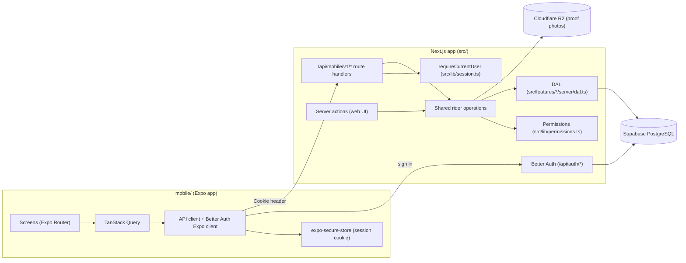

# Parcel Flow — Mobile App (Expo)

## 1. Overview

This document is the long-lived context for the Parcel Flow mobile app. It covers the goal, architecture, conventions, and the roadmap of small OpenSpec changes that build the app step by step. Each OpenSpec change under `openspec/changes/` should link back here instead of repeating this context.

Riders already use the mobile-friendly parcel cards at `/dashboard/rider/parcels`. The native app gives them a better camera flow for delivery proof today, and room for offline work and push notifications later.

---

## 2. Goal and Scope

| Item           | Decision                                                            |
| -------------- | ------------------------------------------------------------------- |
| Platform       | Android first. iOS later from the same Expo codebase                |
| Framework      | Expo (React Native), TypeScript                                     |
| Roles in v1    | Rider only                                                          |
| Live updates   | Pull-to-refresh and refetch when the screen regains focus. SSE later |
| Repo layout    | Same repository, `mobile/` folder with its own `package.json`       |
| Backend        | The existing Next.js app, through a versioned HTTP API              |

### Out of scope for v1

- Admin and super admin screens (they stay on the web)
- Merchant screens (a later phase)
- Offline action queue
- Push notifications
- iOS store release

---

## 3. Architecture

Most Parcel Flow business logic runs in Next.js server actions. A native app can't call server actions, so the mobile app talks to route handlers under `/api/mobile/v1`. Those route handlers and the existing server actions call one shared operation layer, which uses the existing DAL and permission rules. Validation, ownership checks, status transition rules, and financial side effects live in one place.



### Shared operation layer

When a slice exposes a rider action to mobile, it moves the body of the existing server action (validate → authorize → call DAL → invalidate caches) into a function both callers use, for example `src/features/parcels/server/rider-operations.ts`. The server action and the route handler become thin wrappers. The server action keeps its current return shape, and the route handler maps the result to an HTTP status.

---

## 4. Authentication

- Use the Better Auth Expo integration: the `expo()` server plugin from `@better-auth/expo`, plus the Expo client with `expo-secure-store` storage.
- The app signs in with username and password through the existing `/api/auth/*` handler (`src/app/api/auth/[...all]/route.ts`). There is no public sign-up, the same as on the web.
- The session cookie is stored in secure storage and sent as a `Cookie` header on every API request.
- `requireCurrentUser()` in `src/lib/session.ts` reads the session from request headers, so mobile route handlers can use it unchanged.
- `src/proxy.ts` excludes `/api` from its matcher, so mobile API calls are not redirected to dashboard pages.
- The inactive-account guard in `src/lib/auth-session-guard.ts` runs when a session is created, so deactivated users are refused on mobile sign-in too.
- The app scheme `parcelflow://` is always in Better Auth `trustedOrigins` (`src/lib/auth-trusted-origins.ts`). Add Expo Go or development-build origins through `MOBILE_TRUSTED_ORIGINS`. In development, the Expo plugin also trusts `exp://`.
- Better Auth checks origins as CSRF protection, so only on requests that carry cookies. A first sign-in without cookies is protected by the password and the sign-in rate limit.
- Mobile routes use `requireMobileRider()` (`src/features/mobile-api/server/session.ts`): 401 means "sign in again", 403 means "signed in but not allowed".

---

## 5. API Conventions

| Item           | Convention                                                                  |
| -------------- | --------------------------------------------------------------------------- |
| Prefix         | `/api/mobile/v1`                                                            |
| Body (success) | `{ ok: true, message, data? }`                                              |
| Body (error)   | `{ ok: false, message }`                                                    |
| Status codes   | 200, 400 (validation), 401 (no session), 403 (wrong role), 429, 500         |
| Uploads        | `multipart/form-data`, the same limits as the web (5 MB, JPG/PNG/WebP)      |
| Validation     | Zod on the server for every request                                         |
| Contract       | Shared request/response schemas and types in a module with no server imports |
| Demo mode      | Same behaviour as the web, through `src/lib/demo.ts`                         |

The envelope matches the existing `src/app/api/rider/parcels/deliver/route.ts`. Breaking changes go into a new version prefix (`/api/mobile/v2`), because installed app builds can't be updated in step with the server.

---

## 6. Mobile Stack

| Area            | Tool                                                   |
| --------------- | ------------------------------------------------------ |
| Framework       | Expo SDK 58, React Native 0.88                         |
| Navigation      | Expo Router (routes in `mobile/src/app/`)              |
| Language        | TypeScript (strict)                                    |
| Server state    | TanStack Query                                         |
| Styling         | React Native `StyleSheet` + tokens from `DESIGN.md`    |
| Auth            | Better Auth Expo client (pinned to the server version) |
| Secure storage  | `expo-secure-store`                                    |
| Camera / photos | `expo-image-picker`, `expo-image-manipulator` (resize) |
| Tests           | Jest (`jest-expo`) + React Native Testing Library      |
| Builds          | EAS Build (APK for preview, AAB for Play Store)        |

Styling uses plain `StyleSheet` with the `DESIGN.md` tokens in `mobile/src/theme/tokens.ts`, not NativeWind. NativeWind 4 needs Tailwind 3 and extra Babel/Metro setup, while the web is on Tailwind 4. For a handful of screens, tokens are less setup and nothing to keep in step with SDK upgrades.

---

## 7. Repository Layout and Tooling

```text
parcel-flow/
├── src/                 # Next.js web app and API (unchanged location)
├── mobile/              # Expo app, own package.json and bun.lock
│   ├── src/app/         # Expo Router screens (routes only)
│   ├── src/api/         # API client and TanStack Query hooks
│   ├── src/auth/        # Better Auth client, sign-in, sign-out
│   ├── src/components/  # UI primitives
│   ├── src/__tests__/   # screen tests (kept out of src/app so they aren't routes)
│   └── app.json
├── docs/mobile-app.md   # this document
└── openspec/            # one change per slice
```

- The root `tsconfig.json`, `oxlint.config.ts` and `oxfmt.config.ts` exclude `mobile/`. The root `bun test` paths never include it.
- `mobile/` has its own `lint`, `format:check`, `typecheck` and `test` scripts, run by the `mobile` job in `.github/workflows/ci.yml`.
- The Railway deploy builds only the web app; it never installs `mobile/` dependencies.
- The app imports the shared contract as `@parcel-flow/contract`. `mobile/metro.config.js`, `mobile/tsconfig.json` and `mobile/jest.config.js` map it to `src/features/mobile-api/contract.ts`, and resolve its `zod` import from `mobile/node_modules`, so the bundle carries one copy.

### Run the app (Expo Go on an Android phone)

1. Install **Expo Go** from the Play Store. The phone and the Mac must be on the same Wi-Fi.
2. Start the web app with `bun run dev`. `next dev` listens on all interfaces (`0.0.0.0`) by default, so the phone can reach it.
3. Copy `mobile/.env.example` to `mobile/.env` and set `EXPO_PUBLIC_API_URL` to the Mac's LAN address, for example `http://192.168.1.20:3000`. On macOS, `ipconfig getifaddr en0` prints it.
4. `cd mobile && bun install && bun run start`, then scan the QR code with Expo Go.

Expo Go sends an `exp://<lan-ip>:8081` origin, not `parcelflow://`. In development the Better Auth Expo plugin already trusts `exp://`, so local dev needs no extra setup (checked with curl: Expo Go origins get 200, an unknown origin gets 403). To test Expo Go against a deployed environment, set `MOBILE_TRUSTED_ORIGINS=exp://` there.

---

## 8. Roadmap

Each slice is one OpenSpec change, built end to end (API, app screen, tests), in order. After a change is archived, update its status here and plan the next slice in detail.

| #   | OpenSpec change                    | Summary                                                                      | Status      |
| --- | ---------------------------------- | ---------------------------------------------------------------------------- | ----------- |
| 1   | `add-mobile-auth-foundation`       | Better Auth Expo plugin, trusted origins, `GET /api/mobile/v1/me`, contract  | Archived (ahp-sooyaa/parcel-flow#7) |
| 2   | `scaffold-expo-rider-app`          | `mobile/` app, login, secure session, sign out, tooling exclusions, CI job   | In review   |
| 3   | `mobile-rider-parcel-list`         | Paginated rider parcels API, card list, detail, pull-to-refresh              | Planned     |
| 4   | `mobile-rider-start-delivery`      | Shared start-delivery operation, multi-select start delivery                 | Planned     |
| 5   | `mobile-rider-mark-delivered`      | Shared deliver operation, camera proof photo, compression                    | Planned     |
| 6   | `mobile-rider-delivery-failure`    | Report, edit, delete failure notes                                           | Planned     |
| 7   | `mobile-rider-return-to-merchant`  | Complete merchant returns                                                    | Planned     |
| 8   | `mobile-realtime-parcel-updates`   | SSE client on `/api/realtime/parcels`, paused in background                  | Planned     |
| 9   | `android-release-build`            | EAS profiles, icon/splash, versioning, Play Console internal testing         | Planned     |

### Workflow per slice

1. Write the change under `openspec/changes/<name>/` (proposal, design, spec deltas, tasks).
2. `openspec validate <name> --strict`
3. Implement the tasks on a branch, with tests.
4. Open one PR per slice.
5. `openspec archive <name>` after merge, then update the table above.

---

## 9. Later Ideas

- Offline action queue for patchy mobile data (start delivery, failure notes, deliveries with photos)
- Push notifications through Expo Notifications / FCM (new assignments, corrections)
- Merchant role (read-only parcels and settlements)
- iOS build and App Store release
- Burmese localisation
